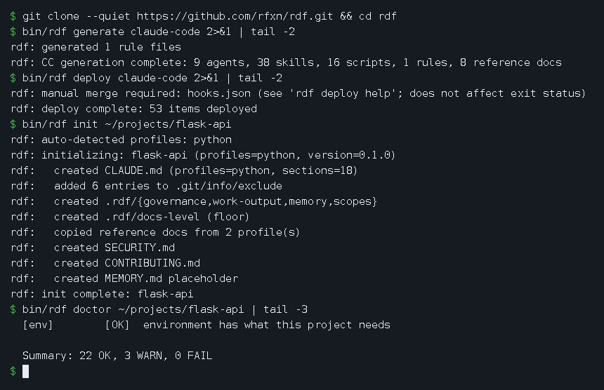
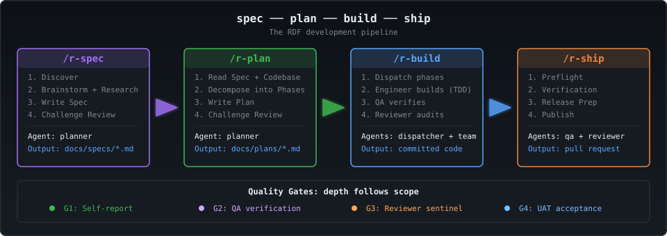

# RDF: spec-driven governance for AI coding agents

[](https://github.com/rfxn/rdf/actions/workflows/ci.yml)
[](LICENSE)
[](https://github.com/rfxn/rdf/releases/latest)


**Make Claude Code, Codex and Antigravity CLI follow your project's rules on every task.**

Drop RDF (rfxn Development Framework) on any repo. It detects your stack, writes project
governance and takes each change from spec to ship, with review gates sized to the work.

**[Quickstart](https://rfxn.github.io/rdf/quickstart.html)** ·
[Documentation](https://rfxn.github.io/rdf/) ·
[Commands](https://rfxn.github.io/rdf/commands.html) ·
[FAQ](https://rfxn.github.io/rdf/faq.html) ·
[Demo walkthrough](https://rfxn.github.io/rdf/demo-walkthrough.html)

<p align="center">
  
</p>

## Quick Start

You need `git`, `bash` 3.2+, `jq` and an AI coding tool.

**From source**, with the full `rdf` CLI:

```bash
git clone https://github.com/rfxn/rdf.git ~/rdf && cd ~/rdf
bin/rdf generate claude-code && bin/rdf deploy claude-code
bin/rdf init ~/projects/my-app    # detects your stack, scaffolds CLAUDE.md and .rdf/
```

**Or as a Claude Code plugin**, with commands namespaced `/rdf:r-*`:

```text
/plugin marketplace add rfxn/rdf
/plugin install rdf@rdf
```

**Then, in your agent session:**

```text
/r-init      scan the code and write project governance
/r-start     see version, plan progress and warnings
/r-spec      describe a change; each command names the next step
```

Hooks, Codex, Antigravity CLI and upgrades are in the
[Quickstart](https://rfxn.github.io/rdf/quickstart.html).

## 1. Why RDF

- **Rules that stick:** agents read your conventions, constraints and checks before they work
- **Review before code:** a reviewer challenges the spec and plan, then audits the diff
- **Evidence at every gate:** test output, grep results and commit hashes
- **Process that scales:** a docs edit gets a self-report; a credential change gets QA and three-pass review
- **One source, several tools:** generates for Claude Code, Codex and Antigravity CLI
- **Visible spend:** `rdf tokens` reports usage from local transcripts, and nothing leaves your machine
- **Small footprint:** the default deploy adds ~0.1K always-loaded tokens, [before `CLAUDE.md` and skills](https://rfxn.github.io/rdf/token-usage.html#what-rdf-adds-to-every-session)

## 2. How It Works

<p align="center">
  
</p>

Seven universal agents handle every project, shaped by governance written for your repo.

Enter at any stage, or skip the pipeline: `/r-plan --bugfix` handles a small fix and
`/r-review` reviews any diff. See [Pipeline and quality gates](https://rfxn.github.io/rdf/pipeline.html).

## 3. Configuration

Most projects need nothing beyond `rdf init` and `/r-init`. Your rules live in plain files:

| To change | Edit |
|-----------|------|
| Project rules | `CLAUDE.md` |
| Generated governance | `.rdf/governance/`, or run `/r-refresh` |
| Detected stack | `rdf init <path> --type rust,infrastructure` |
| Supported tools | `rdf init <path> --tools codex` |

The most specific rule wins:

```text
project CLAUDE.md  >  workspace CLAUDE.md  >  profile defaults  >  core defaults
```

Everything else is in the [configuration reference](https://rfxn.github.io/rdf/configuration.html).

## 4. Usage

| Command | Purpose |
|---------|---------|
| `/r-start` | Load project context and show health |
| `/r-spec` | Research and write a reviewed spec |
| `/r-plan` | Break a spec into phases, or `--bugfix` for a small fix |
| `/r-build` | Execute phases with TDD and quality gates |
| `/r-ship` | Preflight, verify, release |
| `/r-verify`, `/r-review` | Run QA or adversarial review on any diff |
| `/r-save` | Sync plan progress, memory and the session log |
| `rdf doctor` | Check project health and convention drift |
| `rdf tokens` | Report Claude Code and Codex token spend |
| `rdf run`, `rdf account` | Launch a tool in a set mode, on any account |

See all [38 slash commands](https://rfxn.github.io/rdf/commands.html) and the
[CLI reference](https://rfxn.github.io/rdf/cli.html).

<details>
<summary><strong>Exit codes</strong></summary>

| Code | Meaning |
|------|---------|
| 0 | Success |
| 1 | Failure, including a FAIL from `rdf doctor` |
| 2 | Invalid usage from `rdf run` or `rdf tokens`, or an unknown account |

`rdf migrate` has [its own set](https://rfxn.github.io/rdf/cli.html#exit-codes).
</details>

## 5. Supported Tools

Claude Code, Codex and Antigravity CLI are first-class. See [multi-tool parity](https://rfxn.github.io/rdf/multi-tool-parity.html).

| Tool | Commands | Setup |
|------|----------|-------|
| Claude Code | All 38 | `rdf deploy claude-code`, or the plugin |
| Codex CLI | 11 lifecycle | `rdf init <path> --tools codex` |
| Antigravity CLI | 11 lifecycle | `rdf init <path> --tools antigravity` |
| `AGENTS.md` tools | Instructions only | `rdf init <path> --tools agents-md` |
| Gemini CLI | Frozen legacy tier | `rdf generate --deploy gemini-cli` |

## 6. Production Use

RDF governs development of [APF](https://github.com/rfxn/advanced-policy-firewall),
[LMD](https://github.com/rfxn/linux-malware-detect) and
[BFD](https://github.com/rfxn/brute-force-detection), security tools running on ~350,000 servers.

**518** governed sessions · **2,513** git-verified commits · **3** major releases, March to
July 2026 ([details](https://rfxn.github.io/rdf/production.html))

## 7. Documentation

Full docs: **[rfxn.github.io/rdf](https://rfxn.github.io/rdf/)**

- **Start:** [Quickstart](https://rfxn.github.io/rdf/quickstart.html) · [Demo walkthrough](https://rfxn.github.io/rdf/demo-walkthrough.html) · [FAQ](https://rfxn.github.io/rdf/faq.html)
- **Guides:** [Pipeline and gates](https://rfxn.github.io/rdf/pipeline.html) · [Profiles and modes](https://rfxn.github.io/rdf/profiles-modes.html) · [Token usage](https://rfxn.github.io/rdf/token-usage.html) · [Memory](https://rfxn.github.io/rdf/memory-context.html) · [Accounts](https://rfxn.github.io/rdf/accounts.html) · [Parallel sessions](https://rfxn.github.io/rdf/concurrent-sessions.html)
- **Reference:** [Commands](https://rfxn.github.io/rdf/commands.html) · [CLI](https://rfxn.github.io/rdf/cli.html) · [Configuration](https://rfxn.github.io/rdf/configuration.html) · [Agents](https://rfxn.github.io/rdf/agents.html) · [Multi-tool parity](https://rfxn.github.io/rdf/multi-tool-parity.html) · [Status line](docs/context-bar.md)
- **Project:** [Architecture](https://rfxn.github.io/rdf/architecture.html) · [Extending RDF](https://rfxn.github.io/rdf/extending.html) · [Roadmap](ROADMAP.md) · [Changelog](CHANGELOG)

## Contributing

Issues and PRs are welcome, and support is best-effort. See [CONTRIBUTING.md](CONTRIBUTING.md),
[SECURITY.md](SECURITY.md) and [Discussions](https://github.com/rfxn/rdf/discussions).

## License

RDF is released under the [GNU General Public License v2.0](LICENSE).

**7 agents · 38 commands · 16 scripts · 13 profiles · 5 adapters · 7 modes**

(C) 2026 R-fx Networks &lt;proj@rfxn.com&gt;
