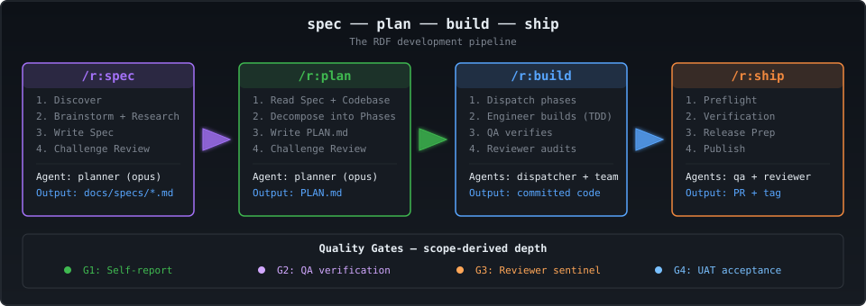
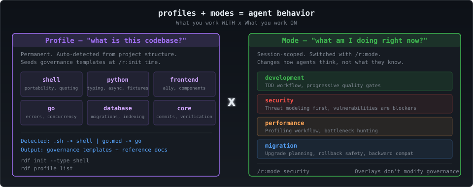

# RDF: rfxn Development Framework

[](https://github.com/rfxn/rdf/actions/workflows/ci.yml)
[](LICENSE)
[](https://github.com/rfxn/rdf/releases/latest)


**Governance-driven AI development for teams that ship to production.**

RDF is a convention governance layer for AI coding agents. It sits between the human and the AI runtime (Claude Code, Codex, Antigravity CLI, plus Gemini CLI legacy), encoding project conventions, quality gates, and domain expertise into typed agent personas, so the AI writes code that actually follows your rules.

> **Drop it on any repo.** `/r-init` auto-detects your stack and scaffolds governance, quality gates, and typed agent personas; no rfxn context required. Battle-tested on production security tooling (APF, LMD, BFD), built to generalize. The value is the pattern: governance-driven agents, adversarial quality gates, convention inheritance, and context-window management. *Issues and PRs welcome; support is best-effort and community-driven.* **[Quickstart: your repo in 5 minutes ->](docs/quickstart.md)**

---

<p align="center">
  
</p>

*Real recorded session: install RDF, initialize a plain Flask project, verify health in 42 seconds, no edits.*

---

## 1. How It Works

<p align="center">
   plan -> build -> ship" width="100%"/>
</p>

Seven universal agents handle every project. Their behavior is shaped by governance files initialized per-project, not baked into prompts. A QA agent reviewing a bash firewall tool and a QA agent reviewing a Python pipeline follow different rules because their governance files are different, not because they are different agents.

---

## 2. Quick Start

```bash
# ── Option A: plugin install (consumer, commands namespaced /rdf:r-*) ──
#   In Claude Code:
#     /plugin marketplace add rfxn/rdf
#     /plugin install rdf@rdf
#   Bootstrap: a SessionStart hook delivers the ~/.rdf/state/ helpers on
#     install; 11 state-backed commands (r-spec/r-plan/r-build/r-ship/
#     r-status/r-env/r-save/r-refresh/r-context-audit/r-vpe/r-util-mem-compact) run
#     degraded only before the first session restart after install; see
#     docs/multi-tool-parity.md.
#   Hooks auto-register on this path (plugin.json declares them); no manual
#     merge. Hooks + status line need jq on PATH. (Only the symlink deploy
#     below requires the manual hooks.json merge.)

# ── Option B: symlink deploy (contributor/power mode, bare /r-*) ──
# 1. Clone
git clone https://github.com/rfxn/rdf.git && cd rdf

# 2. Generate adapter output for your AI tool
bin/rdf generate claude-code          # or: claude-plugin, codex, antigravity, agent-skills, agents-md, gemini-cli (legacy), all

# 3. Deploy (symlinks, so regeneration auto-updates)
bin/rdf deploy claude-code            # or: bin/rdf deploy gemini-cli

# 4. Go to your project
cd /path/to/your/project
```

Then, inside your agent session (Claude Code prompt, not the shell), run
`/r-init`; it auto-detects the project type and suggests profiles.

That's it. Your AI agent now has project-specific governance, quality gates, and domain expertise.

**Verify:**
```bash
bin/rdf doctor                        # health check: artifacts, drift, sync
```

New to RDF? The [5-minute quickstart](docs/quickstart.md) walks this
path on a plain Flask project, with real output at every step.

---

## 3. Configuration

### Environment Variables

| Variable | Default | Purpose |
|----------|---------|---------|
| `RDF_HOME` | resolved from `bin/rdf` | RDF install root (canonical/, lib/, bin/, state/) |
| `RDF_CANONICAL` | `$RDF_HOME/canonical` | Canonical content source tree |
| `RDF_TARGET` | `~/.claude` | Deploy target for claude-code adapter |
| `RDF_ACCOUNT` | unset | Account `rdf run` and `rdf review` use when no `@name` is given (set by `rdf use`; overrides `rdf account default`); `RDF_CLAUDE_ACCOUNT` is still read as a fallback |
| `RDF_WORKSPACE` | parent of `$RDF_HOME` | Workspace root scanned by `rdf doctor --all`. Set this when the checkout lives directly in `$HOME` (e.g. `~/rdf`); `--all` refuses to scan a home directory |

Most users do not need to override these; `bin/rdf` resolves paths from its own location automatically. Overrides matter only for multi-install setups or CI runs against a fixture tree.

### Per-Project Setup

```bash
cd /path/to/project
```

Then, from your agent session: `/r-init` auto-detects profiles and
generates governance.

`rdf init` creates (inside the target project):

| Path | Purpose |
|------|---------|
| `CLAUDE.md` | Project working instructions (typically excluded from commits) |
| `.rdf/governance/` | conventions, constraints, verification, anti-patterns, architecture |
| `.rdf/memory/MEMORY.md` | Session-persistent project facts |
| `.git/info/exclude` entries | Working-file exclusions (CLAUDE.md, PLAN*.md, .rdf/, etc.) |

`rdf init` targets Claude Code by default. Pass `--tools LIST` (comma-separated) to
also wire up other surfaces in the target project: `claude-code` (default,
no-op when combined with others), `agent-skills` (symlinks `.agents/skills`),
`agents-md` (composes `AGENTS.md` from the project's own `CLAUDE.md`), and the
composites `codex` / `antigravity` (both expand to `agent-skills` +
`agents-md`). AGENTS.md composition requires a git repository. An existing
`AGENTS.md` is left untouched.

### Convention Inheritance

The most specific rule wins:

```
project CLAUDE.md   >   workspace CLAUDE.md   >   profile defaults   >   core defaults
```

Agents read the chain at session start and apply it hierarchically. A project CLAUDE.md rule overrides a profile default; a workspace CLAUDE.md rule overrides core.

### Deployment Model

Emergency edits (direct changes to `~/.claude/`) are permitted but must be pulled back to canonical via `rdf sync`. Drift is detected by `rdf doctor --scope content-drift` using per-file `.rdf-hash` sidecars.

```
canonical edits  -->  rdf generate  -->  deployed (~/.claude/, ~/.gemini/, etc.)
deployed edits  <--   rdf sync     <--   (emergency path)
```

### Launching Claude Code and Codex, and Multiple Accounts

`rdf run` launches Claude Code or Codex for an account, and `rdf review` runs a
read-only Codex review (`codex exec`). `rdf c` and `rdf x` are short for
`rdf run claude` and `rdf run codex`, and `-y` is short for `--yolo`:

```bash
rdf run claude @personal --yolo --resume   # --yolo: --dangerously-skip-permissions
rdf c @personal -y --resume                # the same, short
rdf x @work -y                             # --yolo: --dangerously-bypass-approvals-and-sandbox
rdf review --effort high -o /tmp/r.md "Review HEAD~1..HEAD for regressions"
rdf review -f prompt.md -C ~/src/app       # long prompts go through stdin
```

Three launch modes, each named for what it does:

| Mode | Claude Code | Codex |
|------|-------------|-------|
| `-y`, `--yolo` | `--dangerously-skip-permissions` (refused as root) | `--dangerously-bypass-approvals-and-sandbox` |
| `--root` | `--yolo` plus `IS_SANDBOX=1`, which tells Claude Code it is already sandboxed so it skips permissions as root; it isolates nothing | not accepted |
| `--sandbox` | Claude Code's sandbox with permission checks kept: shell commands run without prompts but can write only the working directory and temp and reach only hosts you allow, and cannot ask to leave it; file edits in the working directory are auto-accepted; anything else asks (Linux needs `bubblewrap` and `socat`) | `--sandbox workspace-write --ask-for-approval on-request` |

`--sandbox` does not combine with `--yolo` or `--root`, and refuses tool flags that
would undo it (`--settings`, `--permission-mode`, `-s`, `-a`, the bypass flags).
`rdf run claude` also takes `--chrome`, and `--fs` for `--fork-session`; every
other argument goes to the tool. `rdf review` runs with a read-only sandbox
(`--write` for workspace-write), takes `--effort`, `-m`, `-o` and `-C`, and closes
stdin for a text prompt so a backgrounded run never waits on it.

`rdf shell init` defines an `rdf` shell function so that `rdf use <name>` can set
the account for `rdf run`, `rdf c`, `rdf x` and `rdf review` in the current shell
(`rdf use -` clears it, `rdf use` alone lists accounts); every other command
passes through to the binary. It also adds tab completion for bash and zsh
(subcommands, options, `@accounts`; zsh needs `compinit`). Put the line last in
`~/.bashrc` or `~/.zshrc`:

```bash
eval "$(rdf shell init)"
```

A leading `@<name>` picks an account for one run. `@agent-…`, uppercase names and
paths that exist in the current directory (unless registered as an account)
pass through to the tool. For Claude Code, picking an account sets
`CLAUDE_CONFIG_DIR` and drops inherited credential and provider variables
(`CLAUDE_CODE_OAUTH_TOKEN`, `ANTHROPIC_API_KEY`, `ANTHROPIC_BASE_URL`,
`CLAUDE_CODE_USE_BEDROCK` and the others listed in `rdf run help`) so that
account's login is used against Anthropic. For Codex it sets `CODEX_HOME` to the
account's `~/.codex-<name>` when that exists, else unsets it (`~/.codex`), and
drops `CODEX_API_KEY` and `CODEX_ACCESS_TOKEN`.
Without `@name` or `rdf use`, launches use the account set by
`rdf account default`; with none of these, the environment is left as it is.

`rdf account` runs several Claude Code accounts against one set of projects, auto
memory, `--resume` history and config. The account logged in to `~/.claude` is the
primary. Each other account gets `~/.claude-<name>` with its own login,
`.claude.json` (project trust, user MCP servers, onboarding), plugins and
org-managed settings. It symlinks `projects`, `history.jsonl`, `paste-cache`,
`file-history`, `tasks`, `todos`, `plans`, `CLAUDE.md`, `settings.json`,
`keybindings.json`, `skills`, `agents`, `commands`, `rules`, `output-styles` and
RDF's deployed `scripts`, `governance` and `reference` back to `~/.claude`.

When `~/.codex` exists, each other account also gets `~/.codex-<name>` with its own
Codex login (`auth.json`) and state databases, sharing `config.toml`, `AGENTS.md`,
`history.jsonl`, `prompts`, `rules`, `skills`, `sessions` and `archived_sessions`
with `~/.codex`; it creates `~/.codex/sessions` and `archived_sessions` first, so
`rdf tokens` reads every account's rollouts in one place.
`rdf account primary` moves Claude Code logins only; an account without its own
Codex home uses `~/.codex`.

```bash
rdf account add work --primary   # name the login ~/.claude already holds
rdf account add personal         # create ~/.claude-personal (and ~/.codex-personal)
rdf run claude @personal         # first launch asks you to log in
rdf run codex @personal          # with ~/.codex-personal, Codex asks for its login too
rdf use personal                 # or make it sticky for this shell
rdf account default personal     # or for every launch without @name/rdf use ('-' clears)
rdf account list                 # logins and link health; * = active
rdf account primary personal --dry-run   # preview making personal the ~/.claude login
```

- Every account can resume any transcript and loads the auto memory of the
  project it opens. Work from one account's org reaches the other account's
  provider terms when you open it there.
- The shared `settings.json` applies to every account, including
  `remote.defaultEnvironmentId` and `enabledPlugins`. Keep `forceLoginOrgUUID`,
  `apiKeyHelper` and credential env vars out of it.
- `rdf account link` adds links for entries that appear in `~/.claude` later. It
  never replaces a path that already exists in an account dir.
- `rdf run claude @<name> --chrome` picks the CLI account; the Chrome extension uses whichever
  claude.ai account the browser is signed in to.
- `rdf account primary <name>` makes `<name>` the login in `~/.claude`, which is
  what plain `claude`, IDE extensions and scripts use, and moves the current
  primary's login, `.claude.json`, plugins and org-managed settings to
  `~/.claude-<old>`. Shared state stays where it is, and names keep working with
  `@name`, `rdf use` and `rdf account default`. Quit every Claude Code session first
  (it refuses while one runs), and preview the moves with `--dry-run`. Linux
  only: macOS keeps each login in the keychain under its config dir path.

---

## 4. Usage

### 4.1. Session Lifecycle Commands

| Command | Purpose |
|---------|---------|
| `/r-init` | Initialize governance for a new or existing project |
| `/r-start` | Session initialization: reload context, display project health |
| `/r-save` | End-of-session state sync: PLAN.md, MEMORY.md, session log |
| `/r-mode` | Switch operational mode (development, security, performance, migration, refactoring, debugging, documentation) |
| `/r-status` | Project health dashboard: pipeline position, plan progress, warnings |
| `/r-env` | Environment assessment: code intelligence plugins and language servers, tools, limits, sandbox, Claude Code currency, `.claude` files, price table; exact fixes |
| `/r-refresh` | Re-scan codebase and update governance files |
| `/r-sync` | Pull emergency edits from deployed location back to canonical |
| `/r-context-audit` | Measure Claude Code context overhead; scored report + drift detection |

**Context cost.** RDF's default deploy adds ~0.1K always-loaded tokens per
session: just the lessons index injected at session start (hard-capped at
400 bytes); governance is read on demand, so it costs nothing until an agent
needs it, and `hooks.json` is runtime config that never enters model context.
Figures are a `bytes/4` estimate from `rdf/state/rdf-overhead.sh`, guarded
against drift in CI.

| Deploy | Always-loaded overhead |
|--------|-----------------------:|
| Default | ~0.1K tokens (lessons index only) |
| `--rules` (opt-in scoped governance) | ~2.1K tokens (adds the unscoped core rule) |
| `rdf-lite` (minimal deploy) | ~0.7K tokens (condensed core governance) |

**Token usage.** `rdf tokens` reports what your sessions actually spent, from
the Claude Code transcripts and Codex rollouts already on your machine; with
no tool option it covers Claude Code and, when the project has Codex usage,
Codex too, with a combined total and the most expensive sessions (`--claude`
or `--codex` report one tool). Claude Code usage is deduplicated by
message id (one API turn is logged once per content block), list-price cost,
and breakdowns by cost class, model, agent, context depth, subagent boot cost,
cache rebuilds, and effort. A cache rebuild is a turn that came after the
prompt cache expired (an idle gap over 5 minutes, or over 1 hour when the
turn's 1h-TTL writes exceed its 5m writes) and rewrote at least half of a
context of 50K+ tokens; its cost is the write price minus what reading those
tokens would have cost (main and subagent transcripts are reported separately;
a transcript's first turn never counts; a turn copied into a fork or resumed
transcript counts once).
`--session <id> --summary` is what `/r-save` records per session;
`/r-start` shows it. Codex rollouts are reported the same way
(per-response usage, model and Fast/Standard tier, subagent runs apart from
sessions), split by kind (review for a read-only sandbox, write) and effort, with
the account's plan quota peak per reset window. `--all` covers every project
with a by-project table; `--by day|week|month|session|project` prints one
table instead of the full report. Extracted rows are cached per transcript
and rollout under `~/.rdf/cache/tokens/` and re-extracted when a file's
modification time changes, so a repeat run re-extracts only the files written
since the last run.
Claude Code counts sessions started in the project directory; Codex counts
rollouts whose working directory is the project, below it, or one of the
project's Claude Code scratchpads. Prices are list prices
copied from the Anthropic and OpenAI pricing pages; `--pricing` prints them
with their date and sources. Nothing is sent anywhere.

**Environment.** `/r-env` checks this host against what an optimal setup needs
for the project: a code intelligence plugin and its language server for each
primary language (detected from manifests, ignoring samples, docs and vendored
code), the tools RDF relies on, the hard fd limit, sandbox dependencies, Claude
Code currency on your update channel, `.claude` settings and memory files, and
the price table's age. It prints exact fixes for this host's package manager and
applies none. `/r-start` shows a one-line brief; `rdf doctor` runs it offline as
its `env` scope. Silence a finding by adding its id to `~/.rdf/env-ignore`.

Scoped language rules load only when a matching file is read; they add nothing
to the always-loaded figures. Opt into either variant with a deploy flag:
`bin/rdf deploy --rules claude-code` (scoped governance alongside the default
symlinks) or `bin/rdf deploy --lite claude-code` (rdf-lite: condensed governance,
lifecycle commands only, hooks skipped).

**Scale-adaptive ceremony.** The pipeline scales to the task: pick a tier at
`/r-spec` or `/r-plan` entry: `--full` (default, unchanged), `--quick`
(condensed single-artifact plan, lighter gates), or `--bugfix`
(failing-test-first, minimal gates). A 5-line fix is just `/r-plan --bugfix`.
Tiers only remove ceremony, never safety: security-sensitive changes keep the
full security review regardless of tier. See `canonical/reference/tiers.md`.

### 4.2. Design → Ship Pipeline Commands

| Command | Dispatches | Purpose |
|---------|-----------|---------|
| `/r-spec` | none | Design: discover -> brainstorm -> write spec -> challenge review |
| `/r-plan` | reviewer | Plan: read spec -> decompose into PLAN.md -> challenge review |
| `/r-build [N\|--parallel]` | dispatcher | Execute: TDD cycle per phase with quality gates, parallel batch dispatch |
| `/r-verify` | qa | QA verification against diff or scope |
| `/r-test` | uat | User acceptance testing from end-user persona |
| `/r-review` | reviewer | Adversarial review in challenge or sentinel mode |
| `/r-review-answer` | none | Route review findings to FIX/REBUT/DEFER with audit-trail artifact |
| `/r-verify-claim` | none | Falsifiable claim verification (5 classes), invoked by reviewer on MUST-FIX assertions |
| `/r-audit` | 3x reviewer + qa | Full codebase audit across all domains |
| `/r-audit-slop` | 3x engineer + sentinel | Discovery-first AI slop audit with FP calibration |
| `/r-ship` | qa + reviewer | Release: preflight -> verify -> prep -> publish -> report |
| `/r-vpe` | none | Optional end-to-end pipeline orchestrator (spec->plan->build->ship) |
| `/r-tasks` | none | Read-only task list status: check progress of long-running commands |

### 4.3. Utility Commands (16)

| Command | Purpose |
|---------|---------|
| `/r-util-mem-compact` | Archive stale MEMORY.md entries |
| `/r-util-mem-audit` | Fact-check MEMORY.md against live state |
| `/r-util-chg-gen` | Generate changelog from diff/commits |
| `/r-util-chg-dedup` | Deduplicate changelog entries |
| `/r-util-rel-squash` | Release branch squash plan + execution |
| `/r-util-doc-gen` | Generate publication-ready documentation |
| `/r-util-ci-gen` | Generate GitHub Actions CI workflow |
| `/r-util-lib-sync` | Cross-project shared library drift detection |
| `/r-util-lib-release` | Shared library release lifecycle |
| `/r-util-proj-cross` | Cross-project convention drift analysis |
| `/r-util-code-scan` | Structured pattern-class bug finder |
| `/r-util-code-map` | AST-style structural map for large source files (context-efficient reads) |
| `/r-util-code-modernize` | Codebase modernization assessment |
| `/r-util-test-dedup` | Find duplicate/overlapping tests |
| `/r-util-test-scope` | Test tier recommendation + impact mapping |
| `/r-util-claudemd-review` | CLAUDE.md prose-drift + conversation-driven improvement review |

### 4.4. `rdf` CLI

```
Usage: rdf <command> [subcommand] [options]

Commands:
  generate   Build tool-specific files from canonical sources
  deploy     Deploy generated output to tool destinations
  sync       Pull ~/.claude/ changes back to canonical
  state      Deterministic project state snapshot (JSON)
  tokens     Local token usage report from Claude Code and Codex sessions
  run        Launch Claude Code or Codex for an account (--yolo, @account)
  c, x       Short for run claude, run codex (rdf c -y --resume)
  review     Read-only Codex review run (codex exec) for an account
  use        Account for this shell's launches (needs rdf shell init)
  account    Claude Code and Codex accounts that share projects and memory
  shell      Shell function (rdf use) and tab completion
  github     GitHub Issues + Projects integration
  profile    Manage active domain profiles
  refresh    Agent-driven state file updates
  init       Initialize projects with RDF conventions
  doctor     Check project health and convention drift
  migrate    Migrate project from .claude/ + work-output/ to .rdf/

Options:
  help       Show this help
  version    Show version

Run 'rdf <command> help' for subcommand details.
```

| Command | Key Operations |
|---------|----------------|
| `rdf generate <target>` | `claude-code`, `claude-plugin`, `codex`, `antigravity`, `agent-skills`, `agents-md`, `gemini-cli` (legacy), `all` |
| `rdf deploy <target>` | Symlink output to `~/.claude/`, `~/.gemini/`, etc. |
| `rdf profile list\|install\|remove\|status` | Manage active profiles with dependency resolution |
| `rdf init <path> [--type] [--github]` | Project initialization with governance templates |
| `rdf doctor [--scope] [--all]` | 16 checks: artifacts, drift, memory, plan, github, sync, install-mode, deps, catalogs, state-helpers, content-drift, doc-stats, readme, doc-truth, harness, env |
| `rdf state [<path>]` | JSON snapshot in <1s, no LLM calls |
| `rdf tokens [--claude\|--codex] [--all] [--by VIEW] [--days N] [--session ID] [--json] [--pricing]` | Local token usage report from Claude Code transcripts and Codex rollouts (deduplicated, list-price estimate, cached); `--all` and `--by day\|week\|month\|session\|project` add views; `--pricing` shows the dated, sourced price table |
| `rdf refresh [--scope]` | Re-scan codebase, update governance and state files |
| `rdf sync [--dry-run]` | Emergency: pull `~/.claude/` edits back to canonical |
| `rdf github setup\|sync-labels\|ecosystem-init\|ecosystem-add` | GitHub issue model + project boards |
| `rdf migrate [--dry-run] [--all]` | Migrate project layout from `.claude/` + work-output/ to `.rdf/` |
| `rdf run claude\|codex [@account] [-y\|--yolo \| --root \| --sandbox]` | Launch Claude Code or Codex for an account (`rdf c`, `rdf x` for short); `--root`, `--chrome`, `--fs` for claude |
| `rdf review [@account] [--effort E] [-o FILE] [-C DIR] [--write] PROMPT` | Read-only `codex exec` review run with stdin closed (`-f FILE` or `-` for stdin prompts) |
| `rdf account add\|list\|link\|remove\|default\|primary\|dir` | Claude Code and Codex accounts that share projects, memory and config |
| `rdf use <name>\|-` | Account for this shell's `rdf run`, `rdf c`, `rdf x` and `rdf review` (needs `rdf shell init`) |
| `rdf shell init` | Print the `rdf` shell function (`rdf use`) and bash/zsh tab completion |

### 4.5. Exit Codes

| Exit Code | Meaning |
|-----------|---------|
| 0 | Success |
| 1 | Generic error: command failed, check failed, or FAIL findings reported |
| 2 | Invalid usage: bad arguments or unrecognized subcommand |
| 3 | Missing dependency: required binary (git, jq, sha256sum, etc.) not in PATH |
| 4 | File I/O error: expected file or directory not found / not readable |
| 5 | Drift or sync conflict: `rdf doctor` found divergence that requires user action |

Run `rdf <command> help` for per-command exit semantics.

---

## 5. What Makes RDF Different

### Governance as Code

Every project gets its own governance files (conventions, verification checks, anti-patterns, and constraints) generated from profiles matched to the codebase. The AI reads these before every task. No more re-explaining your rules each session.

### Multi-Adapter Delivery

Write content once in tool-agnostic markdown. Generate for any runtime:

| Adapter | Output | Deploy Target |
|---------|--------|---------------|
| **Claude Code** | YAML-frontmattered agents + `skills/<cmd>/SKILL.md` (intent `description:` frontmatter) | `~/.claude/` |
| **Claude Plugin** | Same skills layout, `/r-X` -> `/rdf:r-X` namespaced, committed output | plugin install (clones repo) |
| **Agent Skills** | `.agents/skills/<cmd>/SKILL.md` (open convention; shared by Codex + Antigravity) | Workspace root |
| **AGENTS.md** | Cross-tool documentation (project-scoped composer) | Project root |
| **Gemini CLI** (legacy) | TOML commands + YAML agents + GEMINI.md | `~/.gemini/` |

Codex and Antigravity CLI are served by the Agent Skills + AGENTS.md
composite (`rdf generate codex` / `antigravity`) rather than a bespoke
adapter directory.

```bash
bin/rdf generate all                  # builds all five adapters in one pass
```

#### First-class multi-tool

Claude Code, Codex, and **Antigravity CLI** are first-class citizens: all
three get intent-triggered commands: Claude Code via `description:`
frontmatter on every generated command, Codex and Antigravity via the shared
`.agents/skills/` SKILL.md surface (`rdf generate agent-skills`, or
`rdf generate antigravity` for skills + AGENTS.md in one pass). The
`gemini-cli` adapter is a **frozen legacy tier** for enterprise Gemini CLI
users (Gemini CLI stopped serving free/Pro/Ultra tiers on 2026-06-18;
Antigravity CLI is its successor and converts the generated TOML on import).
The shared `.agents/skills/` surface is bounded to the 11 lifecycle commands
(not all 38); the parity doc lists them.
Full matrix: [docs/multi-tool-parity.md](docs/multi-tool-parity.md).

### Profiles + Modes

<p align="center">
  
</p>

**Profiles** are the codebase's DNA: auto-detected from project structure, permanent, seeded at `rdf init` time. Thirteen full profiles (`profiles/registry.json`) provide governance templates and reference docs; `rdf-lite` is a condensed deploy variant, not a registered profile. Multiple profiles stack automatically for multi-domain projects (`rdf init --type rust,infrastructure`).

**Full profiles** (13 in `profiles/registry.json`; most ship 3-4 reference docs):

| Profile | Depth | Security Coverage | Refs |
|---------|-------|-------------------|------|
| **core** | Commit protocol, verification, AI agent discipline | Secrets, input validation, injection defense | 3 |
| **shell** | Quoting, portability, error handling, process management | Command injection, TOCTOU races, SUID confusion | 3 |
| **python** | Typing, packaging, fixtures, async patterns | Deserialization, SSRF, import hijacking | 3 |
| **frontend** | Components, a11y (WCAG 2.1 AA), CSS, performance | XSS, CSRF, CSP, auth token storage | 4 |
| **database** | Schema design, migration safety, query discipline | SQL injection, least privilege, RLS | 4 |
| **go** | Error handling, concurrency, interfaces, modules | Race conditions, TLS config, deserialization | 3 |
| **rust** | Ownership, error handling, unsafe discipline, cargo | Unsafe without invariants, yanked crates | 3 |
| **typescript** | Strict mode, async discipline, Node.js backend | Prototype pollution, dependency confusion | 3 |
| **perl** | strict/warnings, three-arg open, regex security, taint mode | Regex DoS, taint bypass, injection via open() | 3 |
| **php** | strict_types, PSR, parameterized queries, Laravel/Symfony | SQL injection, deserialization, SSRF, CSRF | 3 |
| **infrastructure** | Terraform, Kubernetes, Ansible, secrets, CI/CD | State file exposure, secret sprawl, RBAC drift | 3 |
| **node** | Module-system discipline, async patterns, npm hygiene | none (governance-template only) | 0 |
| **rfxn-workspace** | R-fx Networks org overlay, opt-in only, never auto-detected | Shared-library release workflow, consumer verification | 1 |

`rdf-lite` (`profiles/lite/`) is a condensed deploy source for the six
lifecycle commands, not a registered profile.

**Modes** are session-scoped overlays: they change how agents think without modifying governance files. Seven modes cover different workflows: `development` (default), `security`, `performance`, `migration`, `refactoring`, `debugging`, `documentation`.

### Concurrent Session Safety

RDF is designed to be run in parallel against the same repository: different milestones in different terminals, partial work mid-flight in one session while another ships unrelated changes. As of 3.1.0 (Wave A), every session has its own `RDF_SESSION_ID` (the Claude Code session id, else a minted UUIDv7; inherited by all subagents; `claude --resume <id>` keeps it, so resume into a second concurrent terminal with `--fork-session`), and all transient handoff files are scoped by it:

```
.rdf/work-output/
  phase-3-result-<SESSION_ID>.md
  vpe-progress-<SESSION_ID>.md
  build-progress-<SESSION_ID>.md
  sentinel-N-<SESSION_ID>.md
```

Three layers protect concurrent sessions from corrupting each other:

| Layer | Mechanism | Where |
|-------|-----------|-------|
| **Session-scoped state** | Session-id suffix on every transient file | `state/rdf-bus.sh` helpers |
| **Worktree boundary** | Pre-commit hook rejects out-of-scope commits | active on every `rdf/phase-*` branch |
| **Pre-aggregation gate** | Engineer dirty-check before build steps | `engineer.md` Setup |

Plan authors can declare a `**Tests-may-touch:**` glob list (plan schema Rule 8) to pre-authorize trivial test-infra drift (≤30 lines, ≤3 files) without surfacing as out-of-scope. See `docs/specs/2026-04-25-concurrent-sessions-design.md` for the full 12-primitive design.

### Adversarial Quality Gates

The dispatcher auto-derives verification depth from phase content:

| Gate | Agent | Scope Trigger |
|------|-------|---------------|
| G1 | Self-report | All phases |
| G2 | QA (rdf-qa) | scope:focused+ |
| G3 | Reviewer sentinel (rdf-reviewer) | scope:cross-cutting or scope:sensitive |
| G4 | UAT (rdf-uat) | User-facing changes |

The reviewer runs adversarial passes: 2-pass lite (anti-slop, regression) or 3-pass full (adds security). Security findings are **MUST-FIX** in security mode.

---

## 6. The Pipeline

### Design -> Plan -> Build -> Ship

| Stage | Command | What Happens | Artifact |
|-------|---------|-------------|----------|
| **Design** | `/r-spec` | Discover, brainstorm options, research, write spec, challenge review | `docs/specs/*.md` |
| **Plan** | `/r-plan` | Read spec, decompose into phases with TDD steps, challenge review | `PLAN.md` |
| **Build** | `/r-build [N\|--parallel]` | Dispatcher orchestrates: engineer implements, QA verifies, reviewer audits. Parallel dispatch for independent phases. | Committed code |
| **Ship** | `/r-ship` | Preflight checks, verification, release prep, publish, report | PR + git tag |
| **VPE** | `/r-vpe` *(optional)* | End-to-end pipeline orchestrator: intake -> spec -> plan -> build -> ship | All of the above |

Enter at any point. Have a spec already? Start with `/r-plan`. Have a plan? Start with `/r-build`. Each command tells you the next step.

### Audit Pipeline

```bash
/r-audit                              # parallel: 3x reviewer + 1x qa -> AUDIT.md
/r-audit-slop                         # 3x engineer discovery -> sentinel peer-review -> FP validation
```

### Agent Roster

| Agent | Model · Effort | Role | Tools |
|-------|----------------|------|-------|
| **rdf-planner** | fable · high | Design specs, implementation plans (direct dispatch; `/r-spec` and `/r-plan` run inline) | Full read/write |
| **rdf-dispatcher** | opus · high | Phase orchestration, TDD cycles | Full read/write |
| **rdf-engineer** | opus · xhigh | Implementation via governance protocol | Full read/write |
| **rdf-engineer-focused** | opus · medium | Variant of rdf-engineer for `scope:docs`/`scope:focused` phases; failures escalate to rdf-engineer | Full read/write |
| **rdf-qa** | opus · medium | Verification gate (read-only) | Read + execute |
| **rdf-reviewer** | opus · xhigh | Adversarial review: sentinel (read-only) | Read + execute |
| **rdf-reviewer-challenge** | opus · high | Variant of rdf-reviewer for challenge (pre-implementation) review | Read + execute |
| **rdf-uat** | opus · medium | User acceptance from end-user persona (read-only) | Read + execute |
| **rdf-claims** | opus · high | Fresh-context claims check of text before it is posted: PR bodies, commit messages, changelogs, issue and chat drafts (direct dispatch) | Read + execute; Edit disallowed, prompt limits writes to its report, evidence and scratch |

*Routing lives in `adapters/claude-code/agent-meta.json` (`model`, `effort`, `variants`). Variants are generated from the base agent's canonical body; the Agent tool cannot pass effort per call, so each effort level is its own agent. `CLAUDE_CODE_EFFORT_LEVEL` overrides every agent's effort; prefer `/effort`, which saves a level per model. Spec and plan sessions are tuned for `claude --model fable --effort high`, builds for `claude --model opus`. No Fable access? Set the planner's `"model"` to `"opus"` and regenerate. `/r-util-claudemd-review` deliberately fans out to Sonnet for bulk transcript reading.*

### Scripts (16)

| Script | Purpose |
|--------|---------|
| context-bar.sh | Status line: project, branch, phase, model |
| clone-conversation.sh | Fork current conversation to new session |
| half-clone-conversation.sh | Fork recent half of conversation |
| check-context.sh | Context window utilization check |
| setup.sh | First-run environment setup |
| color-preview.sh | Terminal color palette preview |
| test-half-clone.sh | Test harness for half-clone |
| subagent-stop.sh | Capture agent completion events |
| precompact-snapshot.sh | PreCompact hook: snapshot session state before compaction |
| session-start-context.sh | SessionStart(compact) hook: re-inject pre-compaction handoff |
| session-start-inject.sh | SessionStart hook: inject the lessons ID-index |
| session-end-capture.sh | SessionEnd hook: git snapshot to the session journal |
| pre-commit-validate.sh | Pre-commit lint + anti-pattern greps |
| post-edit-lint.sh | Post-edit shellcheck on modified files |
| comment-metrics.sh | Per-file comment cruft metrics for shell source |
| state-bootstrap.sh | SessionStart hook: deliver ~/.rdf/state helpers on plugin installs |

---

## 7. Architecture

### Core Principles

1. **Canonical-first, adapter-delivered.** All content lives as tool-agnostic markdown in `canonical/`. Adapters generate tool-specific output. Develop in canonical, deploy via `rdf generate`.

2. **Governance-driven agents.** Seven universal agents shaped by per-project governance files, not baked-in domain knowledge. Same agent, different governance, different behavior.

3. **Profiles are expertise, modes are methodology.** Profiles define *what the code is* (shell, Python, frontend). Modes define *how you work* (development, security assessment). They compose independently.

4. **Not a runtime.** Claude Code / Codex / Antigravity CLI IS the runtime (Gemini CLI legacy). RDF is the governance layer that tells the runtime how to behave.

5. **Convention over configuration.** Project CLAUDE.md > profile defaults > core defaults. The most specific rule always wins.

### Data Flow

```
canonical/          Adapter            Tool Deployment
  agents/*.md  -->  adapter.sh  -->  output/agents/*.md      -->  ~/.claude/agents/
  commands/*.md     (frontmatter      output/skills/<n>/       ~/.claude/skills/<n>/
                      injection)         SKILL.md               (per-skill symlinks)
  scripts/*.sh                        output/scripts/*.sh     ~/.claude/scripts/
                                                            (symlinks)
```

**Normal:** Edit `canonical/` -> `rdf generate` -> symlinks auto-update.
**Emergency:** Edit `~/.claude/` -> `rdf sync` -> back to canonical.
**Drift check:** `rdf doctor --scope content-drift` -> detects divergence via `.rdf-hash` sidecars.

### Directory Structure

```
rdf/
|-- bin/rdf                             # CLI dispatcher
|-- lib/
|   |-- rdf_common.sh                  # Shared helpers, profile system
|   +-- cmd/                           # Subcommands: generate, profile, init, doctor,
|                                      #   state, tokens, refresh, sync, github, deploy, migrate,
|                                      #   account, shell
|-- canonical/
|   |-- agents/                        # 7 universal agents (pure markdown)
|   |-- commands/                      # 38 commands (/r- namespace)
|   |-- scripts/                       # 16 hook scripts (bash)
|   +-- reference/                     # Framework docs
|-- profiles/
|   |-- registry.json                  # Machine-readable profile catalog (13 profiles)
|   |-- registry.md                    # Human-readable profile catalog
|   |-- detection-rules.md            # Auto-detection signals per profile
|   |-- core/                          # Always active: commit protocol, security hygiene
|   |-- shell/                         # Bash/shell: quoting, portability, BATS
|   |-- python/                        # Python: typing, pytest, packaging
|   |-- frontend/                      # Web: a11y, performance, CSS methodology
|   |-- database/                      # DB: schema, migrations, engine-specific refs
|   |-- go/                            # Go: concurrency, error handling, modules
|   |-- rust/                          # Rust: ownership, unsafe, cargo
|   |-- typescript/                    # TypeScript: strict, Node.js, async
|   |-- perl/                          # Perl: strict/warnings, taint mode
|   |-- php/                           # PHP: strict_types, PSR
|   |-- infrastructure/                # Terraform, K8s, Ansible
|   |-- node/                          # Node.js: module discipline, async, npm hygiene
|   |-- rfxn-workspace/                # R-fx Networks org overlay (opt-in only)
|   +-- lite/                          # rdf-lite deploy source, not a registered profile
|-- modes/
|   |-- development/                   # Default TDD workflow
|   |-- security-assessment/           # Threat-model-first assessment
|   |-- performance-audit/             # Profiling and optimization
|   |-- migration/                     # Version/platform migration
|   |-- refactoring/                   # Behavior preservation
|   |-- debugging/                     # Hypothesis-driven troubleshooting
|   +-- documentation/                 # Read-then-write accuracy review
|-- adapters/                          # 5 adapters (Codex/Antigravity = composite of the two below)
|   |-- claude-code/                   # CC adapter + metadata + hooks -> output/skills/<n>/SKILL.md
|   |-- claude-plugin/                 # CC plugin adapter (namespaced /rdf:r-*, committed output)
|   |-- agent-skills/                  # Shared .agents/skills/<n>/SKILL.md (Codex + Antigravity)
|   |-- gemini-cli/                    # Gemini CLI adapter (TOML, legacy tier)
|   +-- agents-md/                     # Cross-tool AGENTS.md composer
|-- state/
|   |-- rdf-state.sh                   # Project state -> JSON (<1s, timeout-guarded)
|   |-- rdf-tokens.sh                  # Local token usage report (bash + jq)
|   |-- rdf-env.sh                     # Environment assessment (/r-env, /r-start brief, doctor env)
|   |-- context-audit.sh               # Context weight audit -> JSON
|   +-- rotate-work-output.sh          # Age/size-based work-output rotation
+-- reference/                         # Diagrams, architecture docs
```

---

## 8. Production Context

RDF governs development of security infrastructure deployed across ~350,000 active servers:

- **APF** (Advanced Policy Firewall): network access control and rate limiting
- **LMD** (Linux Malware Detect): filesystem malware scanning with daily signature updates
- **BFD** (Brute Force Detection): real-time authentication attack detection

Daily check-ins from government (NIST, NOAA, NIH), defense (NATO CCDCOE), universities (Stanford, Harvard), telecom (Deutsche Telekom, Vodafone, Telefonica), and infrastructure providers (AWS, Hetzner, OVHcloud, DigitalOcean) across cPanel, Plesk, and bare-metal environments.

**What goes wrong when code is wrong:** A false positive in LMD quarantines legitimate files on every server that pulls the update. A regression in APF rule parsing locks administrators out of their own servers. A threshold change in BFD floods block lists or stops detecting real attacks. These are security tools; a regression changes the security posture of hundreds of thousands of machines.

### Measured usage (2026-03 → 2026-07, derived from session logs + git history)

| Metric | Value |
|--------|-------|
| Active servers running governed tools | ~350,000 |
| Governed work sessions logged | 518 across 30+ projects (~17 weeks, ~4.3/day sustained) |
| Commits landed portfolio-wide | 2,513 (git-verified; ~4 per committing session) |
| BATS test cases across governed repos | 6,871 (13 repos, all CI-runnable) |
| Major releases shipped under governance | LMD 2.0, APF 2.0, BFD 2.0, plus 26 RDF releases in 18 weeks |
| Design artifacts committed | 25 specs, 22 implementation plans, designed in the open |

One operator, thirty-plus projects, sustained multi-month cadence, with
every release backed by committed specs, adversarial review, and a test
suite that runs in CI. That is the throughput the governance layer exists
to make safe.

### Project Ecosystem

```
PRODUCTS                    SHARED LIBRARIES
+-----------------+         +-------------+
| APF   2.0.2     |---------| tlog_lib    | structured logging
| BFD   2.0.2     |---------| alert_lib   | Slack/email alerts
| LMD   2.0.1     |---------| elog_lib    | event logging
+-----------------+         | pkg_lib     | package management
+-----------------+         | geoip_lib   | IP geolocation
| Sigforge  1.2.0 |         | batsman     | BATS test infra
| geoscope  1.1.0 |         +-------------+
+-----------------+
```

All projects share: batsman test infrastructure, parent CLAUDE.md conventions, RDF governance pipeline, GitHub label taxonomy.

---

## 9. Philosophy

**Governance overhead is proportional to blast radius.** Security tools running on 350,000 servers need more quality gates than a weekend project. RDF scales governance to risk.

**Agents are context buffers, not general-purpose.** A QA agent loaded with only the diff, test results, and verification protocol catches issues that a general-purpose agent with full context would miss. Narrow context, deep expertise.

**Convention inheritance beats documentation.** Projects inherit conventions from profiles and parent governance files. The AI reads them automatically. No one needs to remember to brief the model on project rules.

**Trust is earned with evidence, not claims.** Every quality gate requires specific evidence: grep output, test results, commit hashes. "I checked and it's fine" is not acceptable.

---

## 10. Extending RDF

<details>
<summary><strong>Add a Command</strong></summary>

1. Create `canonical/commands/<name>.md` (pure markdown, no frontmatter)
2. `rdf generate claude-code` to deploy
3. Add to command table in README

Commands use `/r-<name>` (lifecycle) or `/r-util-<subject>` (utility).
</details>

<details>
<summary><strong>Add an Agent</strong></summary>

1. Create `canonical/agents/<name>.md`
2. Add metadata to `adapters/claude-code/agent-meta.json`:
   ```json
   "<name>": {
     "name": "rdf-<name>",
     "description": "...",
     "tools": ["Bash", "Read", "Glob", "Grep"],
     "model": "opus",
     "effort": "medium"
   }
   ```
   `model` is a Claude Code alias (`opus`, `sonnet`, `haiku`, `fable`,
   `inherit`) or a `claude-*` id; `effort` is `low`..`max`. An optional
   `"variants": {"<key>": {"effort": "...", "description": "..."}}` emits
   `rdf-<name>-<key>` from the same body at a different effort.
3. `rdf generate claude-code` and verify frontmatter
</details>

<details>
<summary><strong>Add a Profile</strong></summary>

1. Add entry to `profiles/registry.json` and `profiles/registry.md`
2. Create `profiles/<name>/governance-template.md` + `reference/`
3. Add detection rules to `profiles/detection-rules.md`
4. `rdf profile install <name>` then `rdf generate claude-code`
</details>

<details>
<summary><strong>Add an Adapter</strong></summary>

1. Create `adapters/<tool>/adapter.sh` implementing `<prefix>_generate_all()`
2. Add case branch in `lib/cmd/generate.sh`
3. Study `adapters/claude-code/adapter.sh` as reference

Contract: read from `${RDF_CANONICAL}`, write to adapter `output/`. Never modify canonical.
</details>

<details>
<summary><strong>Onboard a Project</strong></summary>

```bash
rdf init /path/to/project --type shell --github
```

Creates CLAUDE.md (from governance template), MEMORY.md, `.git/info/exclude`, and optionally GitHub labels + project board.
</details>

---

## 11. Documentation

| Document | Purpose |
|----------|---------|
| **[RDF.md](RDF.md)** | Architecture scope, risk analysis, directory structure |
| **[WORKFORCE.md](WORKFORCE.md)** | Agent workforce, pipeline diagrams, gate details |
| **[reference/diagrams.md](reference/diagrams.md)** | Mermaid diagrams: pipeline, architecture, ecosystem |
| **[docs/multi-tool-parity.md](docs/multi-tool-parity.md)** | First-class trio + legacy gemini feature matrix |
| **[docs/context-bar.md](docs/context-bar.md)** | Status line script reference (layout, segments, install) |
| **[docs/platform-triage.md](docs/platform-triage.md)** | Per-minor native-capability re-triage ledger (`/r-ship` gate) |
| **[CHANGELOG](CHANGELOG)** | Development history |
| **[CHANGELOG.RELEASE](CHANGELOG.RELEASE)** | Release notes (latest release) |

---

## License

RDF is released under the **GNU General Public License v2.0** (GPL v2).

See [LICENSE](LICENSE) for the full text of the license.

Copyright (C) 2026 R-fx Networks &lt;proj@rfxn.com&gt;

---

**7 agents · 38 commands · 16 scripts · 13 profiles · 5 adapters · 7 modes**

(C) 2026 R-fx Networks <proj@rfxn.com>
