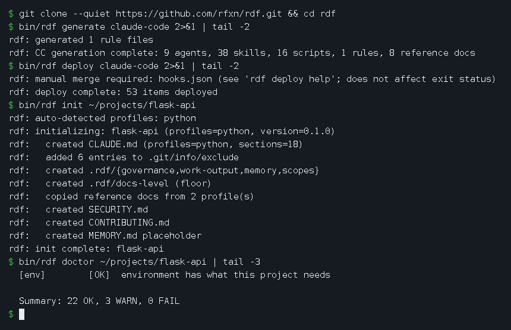
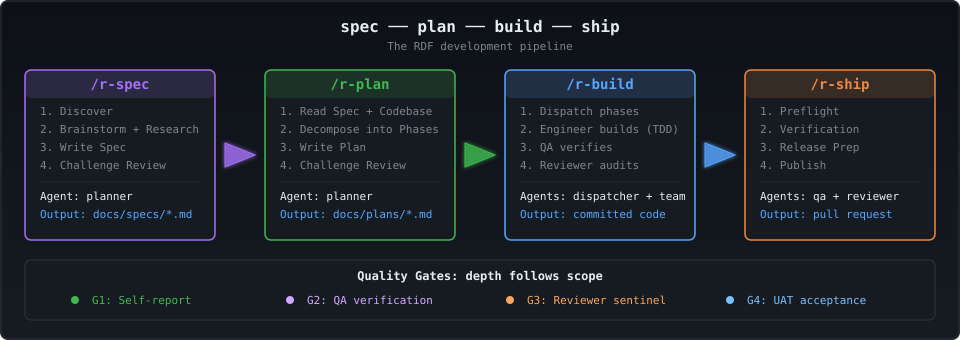

# RDF: spec-driven governance for AI coding agents
{: .fs-8 }

Make Claude Code, Codex and Antigravity CLI follow your project's rules on every task.
{: .fs-5 .fw-300 }

Drop RDF (rfxn Development Framework) on any repo. It detects your stack, writes
project governance and takes each change from spec to ship, with review gates sized
to the work.

[Quickstart: 5 minutes](quickstart.md){: .btn .btn-primary .fs-5 .mb-4 .mr-2 }
[View on GitHub](https://github.com/rfxn/rdf){: .btn .fs-5 .mb-4 }

[](https://github.com/rfxn/rdf/actions/workflows/ci.yml)
[](https://github.com/rfxn/rdf/releases/latest)
[](https://github.com/rfxn/rdf/blob/main/LICENSE)

**7 agents · 38 commands · 13 profiles · 5 adapters · 7 modes**



## Install

**From source** gives you the full toolset, including the `rdf` CLI:

```bash
git clone https://github.com/rfxn/rdf.git ~/rdf && cd ~/rdf
bin/rdf generate claude-code && bin/rdf deploy claude-code
bin/rdf init ~/projects/my-app    # detects your stack
```

**As a Claude Code plugin**, with commands namespaced `/rdf:r-*`:

```text
/plugin marketplace add rfxn/rdf
/plugin install rdf@rdf
```

Then run `/r-init` in your project to generate its governance. The
[Quickstart](quickstart.md) walks through every step with real output.

## What you get

- **Rules that stick:** agents read your conventions, constraints and checks before they work
- **Review before code:** a reviewer challenges the spec and plan, then audits the diff
- **Evidence at every gate:** test output, grep results and commit hashes
- **Process that scales:** a docs edit gets a self-report; a credential change gets QA and three-pass review
- **One source, several tools:** generates for Claude Code, Codex and Antigravity CLI
- **Visible spend:** `rdf tokens` reports usage from local transcripts, and nothing leaves your machine
- **Small footprint:** the default deploy adds ~0.1K always-loaded tokens, [before `CLAUDE.md` and skills](token-usage.md#what-rdf-adds-to-every-session)

## The pipeline



Four commands take a change from idea to release. Enter at any stage, or skip them
for small changes. See [Pipeline and quality gates](pipeline.md).

## Find your way

| I want to | Go to |
|-----------|-------|
| Try it on a repo | [Quickstart](quickstart.md) |
| See a real production change, spec to ship | [Demo walkthrough](demo-walkthrough.md) |
| Look up a command | [Slash commands](commands.md) · [CLI](cli.md) |
| Use Codex or Antigravity CLI | [Multi-tool parity](multi-tool-parity.md) |
| Measure what my sessions cost | [Token usage](token-usage.md) |
| Run several accounts | [Launchers and accounts](accounts.md) |
| Decide whether RDF fits | [FAQ](faq.md) |

## Proven in production

RDF governs development of APF, LMD and BFD, security tools running on **~350,000 servers**.

**518** governed sessions · **2,513** git-verified commits · **3** major releases, March to
July 2026. See [Production use](production.md).

## Get involved

[Issues](https://github.com/rfxn/rdf/issues) ·
[Discussions](https://github.com/rfxn/rdf/discussions) ·
[Contributing](https://github.com/rfxn/rdf/blob/main/CONTRIBUTING.md) ·
[Security policy](https://github.com/rfxn/rdf/blob/main/SECURITY.md) ·
[Privacy policy](privacy.md)
