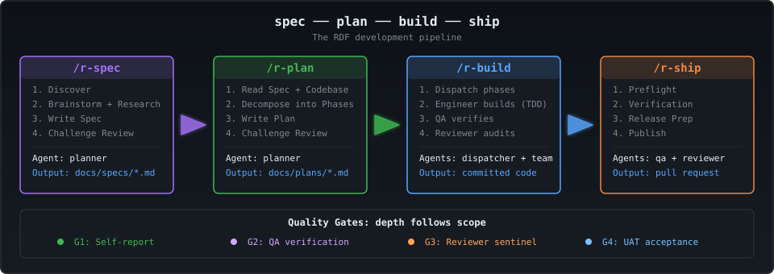

# Pipeline and quality gates
{: .no_toc }

Spec-driven development for AI coding agents: design first, plan in phases,
build with TDD, and release only with evidence.

1. TOC
{:toc}

## The four stages

| Stage | Command | What happens | Output |
|-------|---------|--------------|--------|
| Design | `/r-spec` | Discover the problem, research options, write the spec, run a challenge review | `docs/specs/*.md` |
| Plan | `/r-plan` | Read the spec and code, decompose into TDD phases, run a challenge review | `docs/plans/*-plan.md` |
| Build | `/r-build [N\|--parallel]` | The dispatcher runs each phase: engineer implements, QA verifies, reviewer audits | Committed code |
| Ship | `/r-ship` | Preflight, verification, release prep, publish, report | Pull request |

Enter at any point. Have a spec already? Start with `/r-plan`. Have a plan?
Start with `/r-build`. Each command tells you the next step.

`/r-vpe` is an optional orchestrator that runs the whole pipeline from one
outcome-oriented request.

## Pick a tier

Not every change deserves the full process. Choose a tier at `/r-spec` or
`/r-plan`. RDF suggests one from the request, you confirm it, and pressing Enter
keeps `--full`.

| Flag | Use it for | Spec | Plan review | Build gates |
|------|-----------|------|-------------|-------------|
| `--full` (default) | Multi-component work or open design questions | `docs/specs/*.md` | Challenge review | Set by scope (below) |
| `--quick` | Well-understood changes to about 3 files, with no open architecture questions | Condensed | Single review | Gate 3 capped at sentinel-lite |
| `--bugfix` | A defect you can reproduce with a test | None, the failing test comes first | Schema check only | Gate 1 plus a regression-only sentinel-lite |

A five-line fix is just `/r-plan --bugfix`, then `/r-build`.

{: .note }
Tiers only remove ceremony, never safety. Security-sensitive changes keep QA and
the full 3-pass review whatever the tier. Details: [`canonical/reference/tiers.md`](https://github.com/rfxn/rdf/blob/main/canonical/reference/tiers.md).

## Quality gates

The dispatcher derives verification depth from what each phase touches, so you
never tag a phase by hand.

| Gate | Who runs it | What it checks |
|------|-------------|----------------|
| 1 | Engineer | Self-report with evidence |
| 2 | QA (`rdf-qa`) | The project checks in `governance/verification.md`: lint, tests, anti-patterns |
| 3 | Reviewer sentinel (`rdf-reviewer`) | Adversarial review. Lite is 2 passes (anti-slop, regression); full adds security |
| 4 | UAT (`rdf-uat`) | Real-world scenarios, install flows and CLI use from an end-user persona |

| Scope | The phase touches | Gates |
|-------|-------------------|-------|
| `scope:docs` | Documentation, changelog or comments only | 1 |
| `scope:focused` | One file, or only config and scaffolding | 1, 2 |
| `scope:multi-file` | Two or more source files (the default when scope is unclear) | 1, 2, 3 lite |
| `scope:cross-cutting` | Install scripts, CLI entry points, cross-OS logic, breaking changes | 1, 2, 3 full |
| `scope:sensitive` | Security-critical paths, shared libraries, data migration, credentials | 1, 2, 3 full |

Gate 4 is added at any scope when a phase changes CLI entry points, help text or
man pages. Files named in your `governance/constraints.md` and
`governance/anti-patterns.md` raise the scope, so your own rules steer the gates.

A `--full` plan with 3 or more phases also ends with a full 3-pass sentinel review of
its cumulative diff.

## Review without the pipeline

Every gate is available on demand:

| Command | Use it to |
|---------|-----------|
| `/r-verify` | Run a QA pass on a diff or scope |
| `/r-review --challenge <file>` | Challenge a spec or plan before implementation |
| `/r-review --sentinel` | Audit finished work (2 or 3 passes) |
| `/r-review-answer` | Route findings to fix, rebut or defer, with an audit trail |
| `/r-test` | Run user acceptance tests from an end-user persona |

## Audit a whole codebase

| Command | What it does | Output |
|---------|--------------|--------|
| `/r-audit` | Three reviewers and QA across all domains, in parallel | `AUDIT.md` |
| `/r-audit-slop` | Finds dead code and orphan helpers, then a sentinel peer-reviews findings to remove false positives | Validated findings |

## See it run

The [demo walkthrough](demo-walkthrough.md) follows a real production change
through every stage, with the actual gate results.
