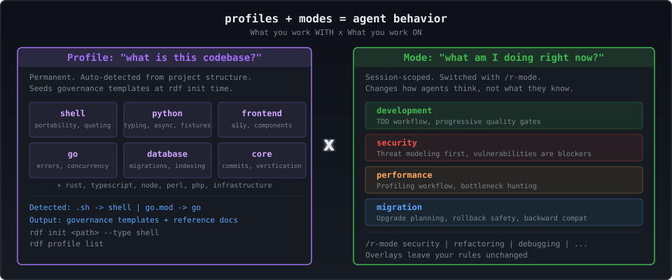

# Profiles and modes
{: .no_toc }

A **profile** says what the code is. A **mode** says how you are working right
now. They compose independently, which is why the same agents behave
differently on a bash firewall and a Python pipeline.

1. TOC
{:toc}



## Profiles

Profiles seed governance for a stack. `rdf init` detects them from project
structure, and they stay with the project. Several stack automatically on
multi-domain repositories:

```bash
rdf init ~/projects/app                          # auto-detect
rdf init ~/projects/app --type rust,infrastructure   # force a set
rdf profile list                                 # see what is available
```

| Profile | Covers | Security focus | Refs |
|---------|--------|----------------|------|
| **core** | Commit protocol, verification, AI agent discipline (always active) | Secrets, input validation, injection defense | 4 |
| **shell** | Quoting, portability, error handling, process management | Command injection, TOCTOU races, SUID confusion | 3 |
| **python** | Typing, packaging, fixtures, async patterns | Deserialization, SSRF, import hijacking | 3 |
| **frontend** | Components, a11y (WCAG 2.1 AA), CSS, performance | XSS, CSRF, CSP, auth token storage | 4 |
| **database** | Schema design, migration safety, query discipline | SQL injection, least privilege, RLS | 4 |
| **go** | Error handling, concurrency, interfaces, modules | Race conditions, TLS config, deserialization | 3 |
| **rust** | Ownership, error handling, unsafe discipline, cargo | Unsafe without invariants, yanked crates | 3 |
| **typescript** | Strict mode, async discipline, Node.js backend | Prototype pollution, dependency confusion | 3 |
| **node** | Module-system discipline, async patterns, npm hygiene | Governance template only | 0 |
| **perl** | strict/warnings, three-arg open, regex security, taint mode | Regex DoS, taint bypass, injection via open() | 3 |
| **php** | strict_types, PSR, parameterized queries, Laravel and Symfony | SQL injection, deserialization, SSRF, CSRF | 3 |
| **infrastructure** | Terraform, Kubernetes, Ansible, secrets, CI/CD | State file exposure, secret sprawl, RBAC drift | 3 |
| **rfxn-workspace** | R-fx Networks org overlay, opt-in only and never auto-detected | Shared-library release workflow, consumer verification | 1 |

*Refs* counts the reference docs copied into `.rdf/governance/reference/`.
Detection signals live in [`profiles/detection-rules.md`](https://github.com/rfxn/rdf/blob/main/profiles/detection-rules.md).

## Modes

Modes are session-scoped overlays. They change how agents think, and the only
governance edit is the `Mode:` line in `.rdf/governance/index.md`. Switch with
`/r-mode <name>`:

| Mode | Use it for |
|------|-----------|
| `development` | The default TDD workflow: features, bug fixes, refactoring |
| `security` | Threat modeling, vulnerability analysis, hardening |
| `performance` | Profiling, optimization, bottleneck analysis |
| `migration` | Upgrades, platform moves, data transforms |
| `refactoring` | Large restructuring and code movement, preserving behavior |
| `debugging` | Hypothesis-driven bug hunts, incident response, root cause analysis |
| `documentation` | Read-then-write work: README rewrites, API docs, man pages, guides |

Short aliases work too: `dev`, `refactor`, `debug` and `docs`.

Modes affect gates. In `security` mode, for example, the security review pass
becomes blocking.

## Which rules win

The most specific rule wins:

```text
project CLAUDE.md  >  workspace CLAUDE.md  >  profile defaults  >  core defaults
```

A project rule overrides a profile default, and a workspace rule overrides core.
See [Configuration](configuration.md) for the files involved.
